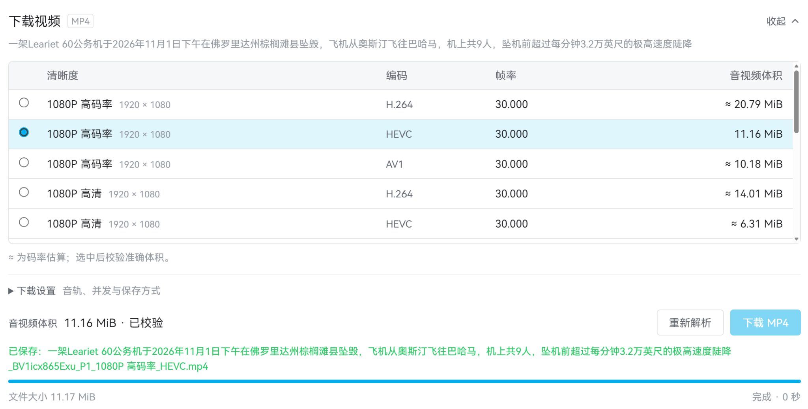

# B站原生下载

一个油猴脚本，在 B站视频页的“分享”旁边加上“下载”按钮。点开后，下载区域直接在操作栏下方展开，选好画质就能保存为带声音的 MP4。



## 安装

推荐 **Edge / Chrome + Tampermonkey**。

1. [点击安装脚本](https://github.com/unicbm/bilibili-native-download/raw/refs/heads/main/dist/bilibili-native-download.user.js)，在油猴弹出的页面确认安装。
2. 如果没有弹出安装页面，就把文件下载下来，在油猴控制面板的“实用工具”里从文件导入。也可以新建脚本，粘贴文件全部内容并保存。
3. 刷新已打开的 B站视频页，让脚本生效。

当前版本 **1.1.2**。已安装旧版的话，重新点安装链接覆盖更新，然后刷新视频页。

1.1.2 修复了加载脚本后 B站顶栏消失的问题。下载按钮会等页面初始化完成后出现。

脚本的 `unsafeWindow` 授权用于打开浏览器的文件夹选择窗口。

## 怎么用

1. 在浏览器里登录 B站，打开想下载的视频。
2. 点击“分享”旁边的“下载”，面板会在操作栏下方展开。
3. 选择画质，等体积显示“已校验”。不知道选哪个编码就用默认的 **H.264**。
4. 点击“下载 MP4”，选择保存文件夹并允许写入，等页面显示“已保存”。下载时保持这个标签页打开。

音轨、并发和保存方式都在“下载设置”里。默认 4 路并发即可；点击“下载”或“收起”可以折叠面板，下载会继续，再展开就能看进度。

## 重复下载与同名文件

使用“直接写入磁盘”时，你只需选择保存文件夹。脚本会生成带时间和随机尾码的新文件名，重复下载同一个视频会保存成另一份。

如果发现同名文件，脚本会重新生成名字，同名的空文件也会避开。目录没有写入权限或文件被占用时，会停止保存并提示重新选择文件夹。

失败或取消后，可能留下这次新建的空文件；成功完成后才会显示“已保存”。脚本不会为了重试而删除已有文件。

## 能做什么

- 列出当前账号可用的画质，以及 H.264、HEVC、AV1 编码选项。
- 显示文件大小。列表先给估算值，选中后读取准确的音视频体积。
- 测试视频的 CDN 主备线路，优先用测得更快的地址，失败时尝试备用线路。
- 分片并发下载，默认 4 路，可以改成 1、2、6 或 8 路。
- 在浏览器里合并音视频，不转码，不需要额外安装 FFmpeg。

登录状态直接沿用当前浏览器，不用手填 Cookie。默认选当前可用的最高画质和 H.264，音频选 AAC。

## 使用时注意什么

长视频选“直接写入磁盘”，选择保存文件夹后会边下载边写入文件。浏览器不支持这个功能时，可以用“内存下载”，上限是 256 MiB。

点击“取消”后，下次需要重新开始。当前没有跨刷新断点续传。

CDN 测速每条线路最多读取 256 KiB。选线和并发可能改善单连接慢、默认线路差的问题，实际速度仍受本地网络和 CDN 限制，先用默认 4 路就行。

体积显示的是原始音视频流之和，合成后的 MP4 大小会略有变化。

目前支持普通 BV / AV 视频页及当前分 P。直播、番剧、批量下载、杜比视界、FLAC / 杜比音轨、加密媒体和旧版 `durl` 格式暂不支持。

## 开发

需要 Node.js 22 或更新版本。

```sh
npm ci
npm run build
```

生成的安装文件在 `dist/bilibili-native-download.user.js`。用户安装这个文件即可，不需要 Node.js。

运行测试需要另外安装 `ffmpeg` 和 `ffprobe`：

```sh
npm test
```

核心代码在 `core.js`、`network.js`、`range-engine.js`、`engine.js` 和 `main.js`，分别负责视频信息、网络请求、分片下载、音视频合成和界面。`safe-target.js` 负责新文件命名、重名检查和写入提交。

## 许可与依赖

项目代码使用 [MIT 许可](LICENSE)。音视频合成使用 [Mediabunny](https://github.com/Vanilagy/mediabunny) 1.65.0，按 [MPL 2.0](vendor/LICENSE) 许可随脚本打包，[对应版本的上游源码](https://registry.npmjs.org/mediabunny/-/mediabunny-1.65.0.tgz)可从 npm 获取。
